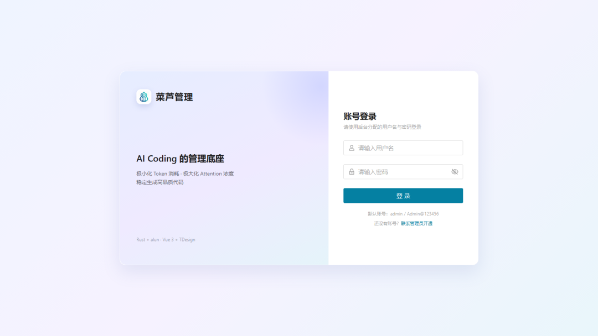
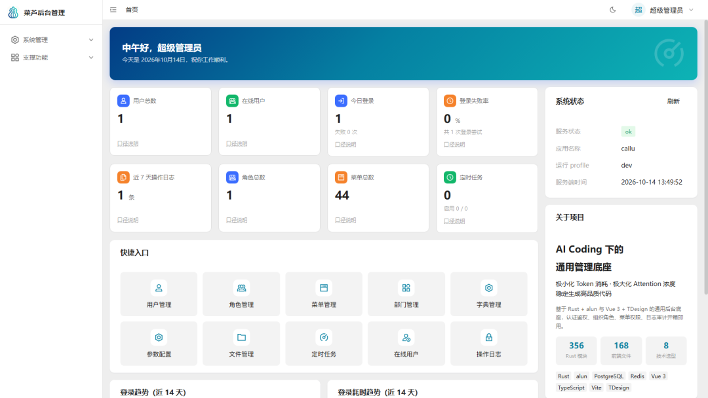
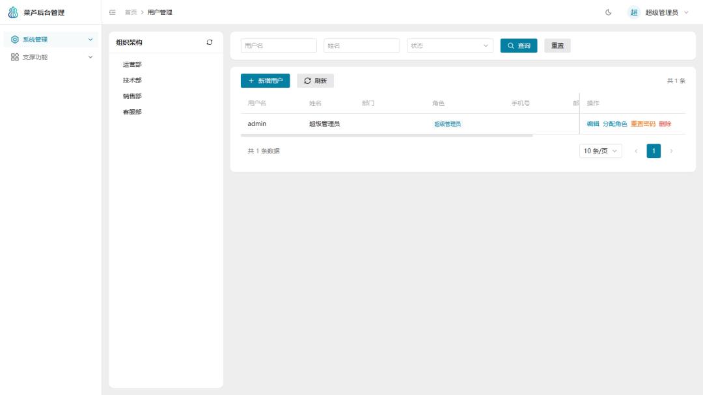
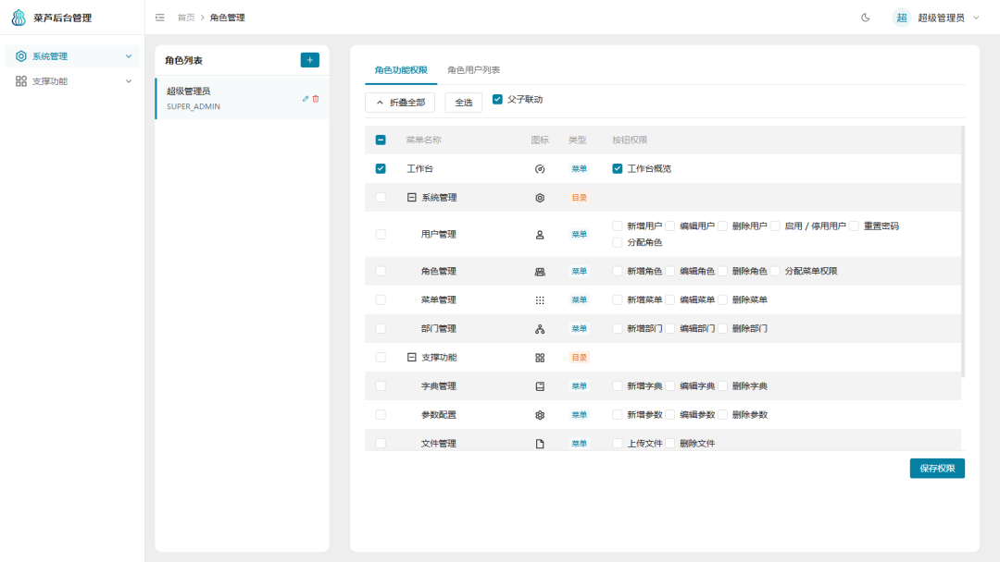
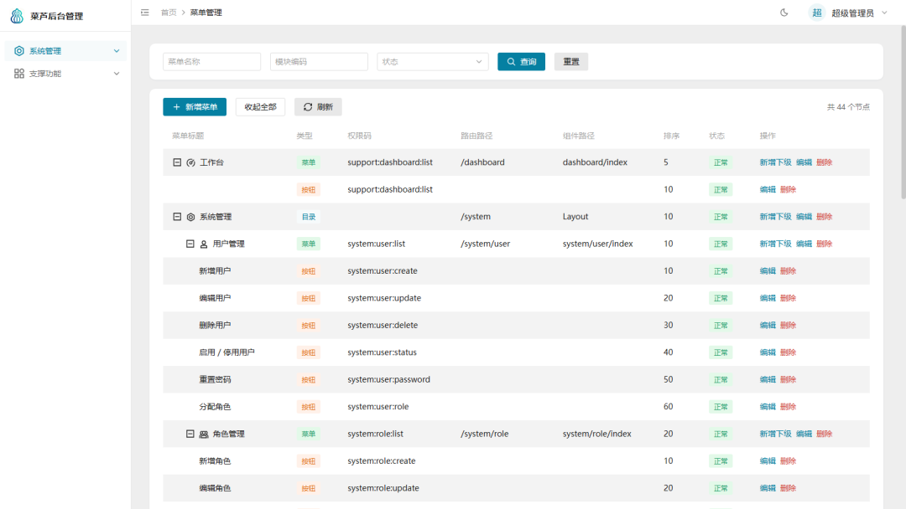
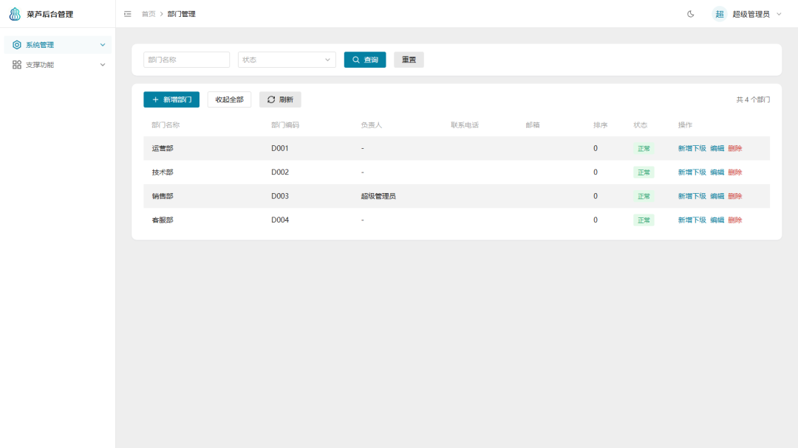
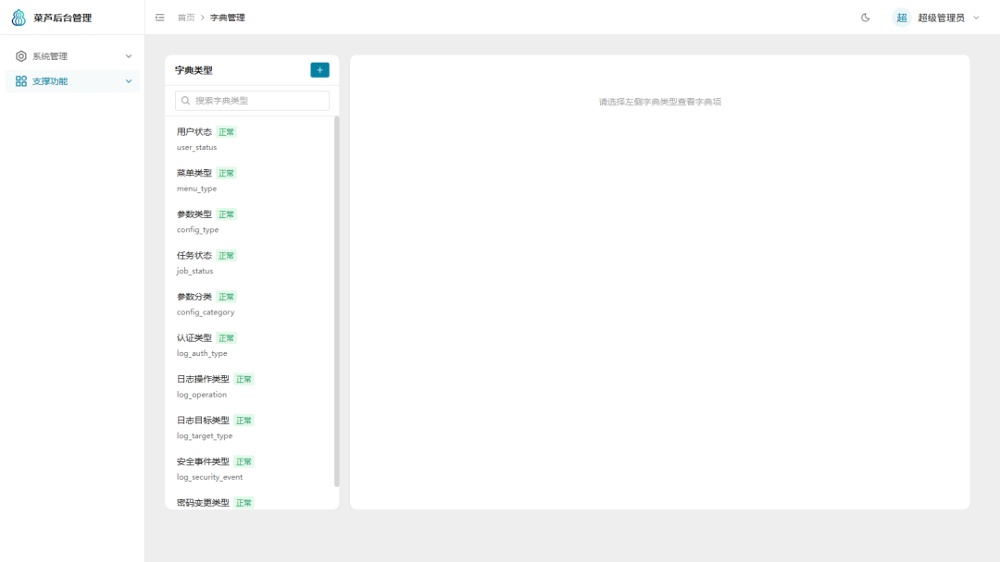
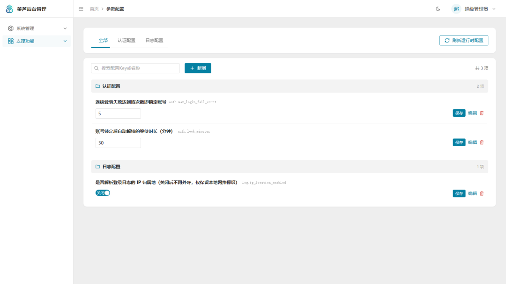
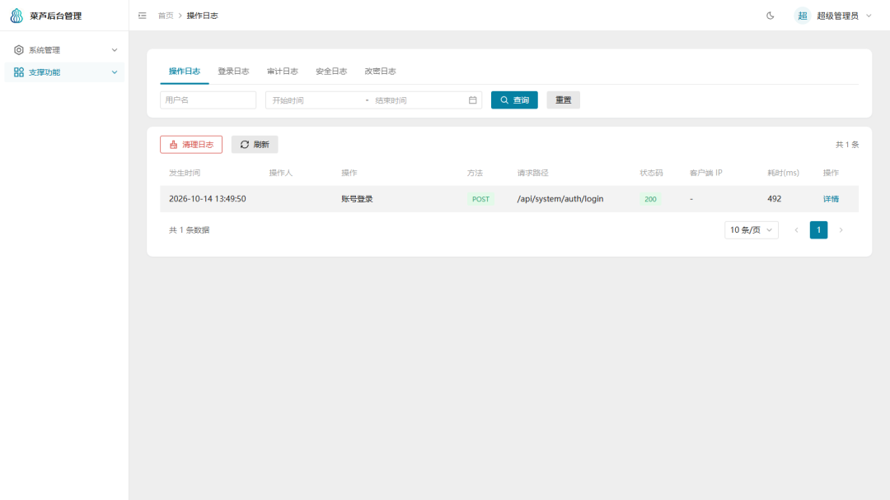
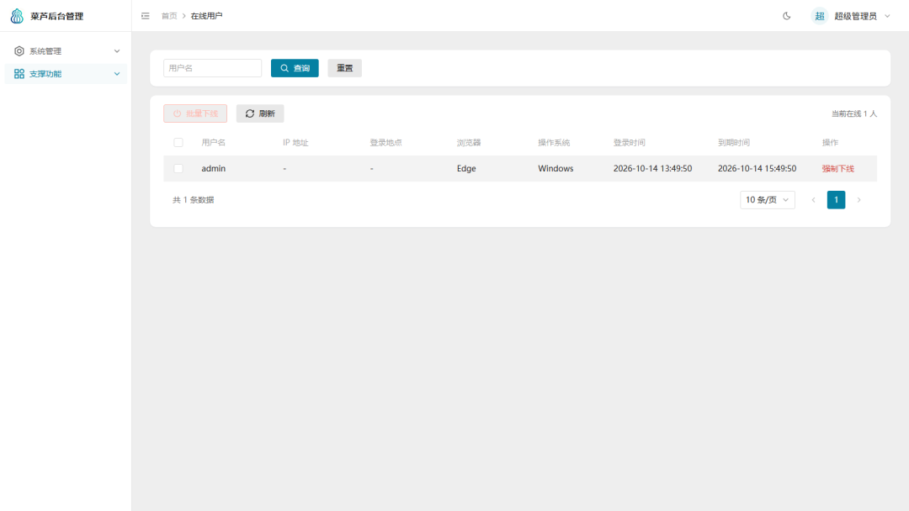

# 菜芦通用后台系统（Cailu）

一套基于 **Rust（Alun 框架） + Vue 3 + TDesign** 的通用后台管理系统底座，覆盖登录鉴权、RBAC 权限、组织架构（部门）、数据字典、系统参数、文件管理、多类日志、定时任务、在线用户等管理系统必备能力，不含业务代码，可作为新业务系统的起手模板。

本仓库对应 `菜芦系统` 中的**基础版 `cailu`**（独立项目，可单独开发、构建、部署）。

## 运行效果图

| 登录页 | 首页工作台 |
|:---:|:---:|
|  |  |
| **用户管理** | **角色管理** |
|  |  |
| **菜单管理** | **部门管理** |
|  |  |
| **字典管理** | **参数配置** |
|  |  |
| **操作日志** | **在线用户** |
|  |  |

## 目录结构

```text
cailu/
├── backend/            # 后端：Rust crate `cailu`（二进制同名）
│   ├── Cargo.toml      # 只声明 alun 门面 + feature
│   ├── config/         # config.toml + dev/test/prod profile
│   ├── migrations/     # 迁移（system/、support/、business/、seed/ 按业务域分目录）
│   ├── uploads/        # 上传文件落盘
│   └── src/            # main.rs / lib.rs / bootstrap.rs / system / support / business / 横切层
├── frontend/           # 前端：Vue 包 `@cailu/web`（Vite + TDesign + Pinia）
│   ├── vite.config.ts  # 开发代理 /api、/health → 127.0.0.1:8023
│   ├── deploy/nginx.conf
│   └── src/            # api / router / stores / layouts / views / components
├── docs/
│   └── README.md        # 二开文档集总入口（见 docs/README.md）
├── docker/             # 部署编排：dev 依赖 compose（PG+Redis）、prod 完整编排、前后端 Dockerfile
└── scripts/            # 工程脚本：dev / check / build / deploy / init-db
```

> **二开推荐**：`system/` 与 `support/` 是框架内置底座；**新业务代码统一放在 `business/` 容器下**（后端 `backend/src/business/<模块>/`、前端 `frontend/src/api/business/` 与 `frontend/src/views/business/<模块>/`），与底座平级隔离，不侵入框架底座代码。

## 技术栈

| 端 | 核心 | 说明 |
|----|------|------|
| 后端 | Rust 1.94.1+ / edition 2024 | `alun` 门面框架（axum 0.8）|
| 后端 | PostgreSQL ≥ 14 | 主库（17 张表），`deleted_at` 软删 + 部分唯一索引 |
| 后端 | alun 内置 | 配置三层覆盖、迁移 runner、缓存抽象（本地/Redis）、JWT 双令牌 |
| 前端 | Vue 3.5 + TS 5.8 + Vite 6 | TDesign 1.19、Pinia 3、Vue Router 4、axios、ECharts 5 |
| 包管理 | pnpm 10.5.0 | `packageManager` 已固定，需 Node ≥ 22.13 |

## 快速开始

### 0. 开发依赖（PostgreSQL + Redis）

```bash
docker compose -f docker/docker-compose.yml up -d   # 拉起 PG（库 cailu）与 Redis
# 或不用 docker：先装好 PG，再执行 bash scripts/init-db.sh 建库
```

> 也支持一键启动全部：`bash scripts/dev.sh`（依赖容器 + 后端 + 前端）。

### 后端

```bash
cd cailu/backend
cargo run                                  # 自动迁移 + 启动（http://127.0.0.1:8023）
cargo run -- print-config                  # 核对配置生效结果
cargo check                                # 编译检查
cargo fmt && cargo clippy -- -D warnings   # 提交前检查
```

### 前端

```bash
cd cailu/frontend
pnpm install
pnpm dev                                   # http://localhost:5173（代理 /api、/health → 8023）
pnpm typecheck                             # TS 类型检查
pnpm build                                 # 类型检查 + 生产构建（dist/）
```

### 工程脚本

| 脚本 | 作用 |
|------|------|
| `bash scripts/dev.sh` | 一键启动开发环境（依赖容器 + 后端 + 前端） |
| `bash scripts/check.sh` | 提交前检查（后端 fmt/clippy/check + 前端 typecheck） |
| `bash scripts/build.sh` | 构建后端 release 二进制 + 前端 dist |
| `bash scripts/deploy.sh` | 生产部署（构建产物 + 镜像 + 完整编排，见 docker/docker-compose.prod.yml） |
| `bash scripts/init-db.sh` | 初始化本地 PG 的 `cailu` / `cailu_test` 库 |

### 默认账号

- 用户名：`admin`
- 密码：`Admin@123456`（回退值；生产用 `ALUN_ADMIN_PASSWORD` 注入，首次登录后立即修改）
- 角色：`SUPER_ADMIN`（跳过全部权限校验）

## 文档与技能

| 文档 | 用途 |
|------|------|
| [docs/README.md](docs/README.md) | 二开文档集总入口：项目结构、设计亮点、前后端二开指南、编码规范、AI 二开指引 |
| [skill/SKILL.md](skill/SKILL.md) | 项目二开技能（AI 知识包）：强制编码规范、新增模块快速流程、关键文件速查 |

> 二开建议直接在 IDE 中把该 SKILL.md 作为项目上下文使用，可显著缩短上手成本。

## 命名约定

| 项 | 值 |
|----|----|
| 仓库 / 项目目录 | `cailu/cailu` |
| Rust crate / 二进制 | `cailu` |
| Vue 包 | `@cailu/web`（前端目录 `frontend/`） |
| 数据库 | `cailu` |
| 后端端口 | `8023` |
| 前端 dev 端口 | `5173` |

## 联系方式

技术交流、问题反馈或商务合作，欢迎扫码添加微信：


## 许可证

本项目采用 **Apache License 2.0**，全文见 [LICENSE](LICENSE)。

选择 Apache 2.0 而非 MIT 的原因：在同样宽松（可商用、可修改、可闭源分发）的前提下，
它**显式包含专利授权条款**（第 3 条），企业法务在评估「可自由采用」时更放心；
而后台脚手架的价值来自被大量采用，宽松协议的传播成本最低。

> 专业版 `cailu-pro` 与企业版 `cailu-saas` 是**独立仓库的专有软件**，不适用本许可证。

